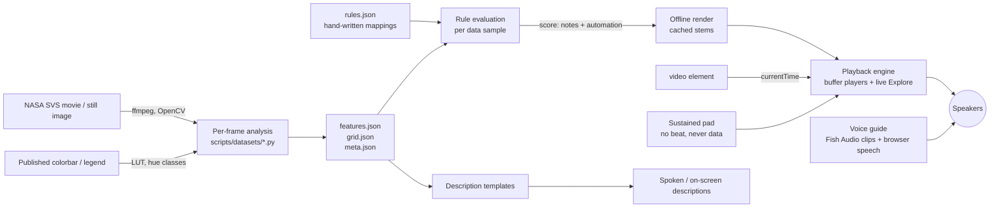

# Methods: how a visualization becomes sound, and why

## 1. Overview

All image analysis runs offline in Python, so every number the sound uses is inspectable in `public/data/<id>/`. A visualization is defined by data, not code: a `rules.json` says which feature drives which sound target, over what range, with which curve, and *why*.

## 2. Research basis

| Source | What we took from it |
|---|---|
| NASA Chandra / SYSTEM Sounds (Arcand, Russo et al.; [NASA](https://www.nasa.gov/data-sonifications/), [Frontiers 2024](https://www.frontiersin.org/journals/communication/articles/10.3389/fcomm.2024.1288896/full)), tested with 3,184 blind, low-vision and sighted listeners | image scan left → right over time; **vertical position → pitch**, **brightness → loudness**, horizontal → stereo; compact sources as notes, extended areas as continuous tone. → the **Box** tool and the gliding guide tone. |
| NASA Hearing Hubble ([app](https://science.nasa.gov/specials/apps/hearing-hubble/)) | a playhead scanning a still image; brightness → pitch; consonant "mood" scales (Relaxed…); soft waveforms. → **Row / Column** sweeps, the **Mood** choice, pentatonic scales. |
| Walker & Nees, *Sonification Handbook* ch. 2; Walker & Lane, ICAD 2001 | choose each mapping's **polarity** and **scaling** explicitly; positive polarity for temperature, amount, activity (more = higher). |
| Highcharts sonification docs; Evershed 2024 guidelines (after Brown et al. 2003, Nees & Walker 2007, Smith & Walker 2005) | pitch range about G3–C6; **1–8 notes per second**; change at most 2–3 sound parameters at once; **reference tones** (lowest / highest) as the y-axis; context cues (ticks) in a **different timbre**; separate streams by pan and timbre. |
| Variable-Tempo sonification ([arXiv 2508.06872](https://arxiv.org/pdf/2508.06872)) | **note rate can carry data** and is easier to judge than a fixed beat. → density sets how often the note repeats; there is no other beat. |
| iSonic (Zhao, Plaisant, Shneiderman, Lazar), Hunt & Hermann ICAD 2004 | keyboard map exploration with row / column overviews; a tight, continuous feedback loop. → Explore's Point tool glides immediately. |
| Web Speech API + ARIA live-region practice (MDN, Orange a11y guidelines) | speak only on user action; cancel the previous utterance; duck the music; never speak the same text twice through the voice and the screen reader. |

## 3. Playback: every onset is data

The previous version layered a fixed bass pulse, a random melody "wander", random harp sparkles and randomly gated flute / bass notes on top of the data. Listeners could not tell which rhythm was information. The score (`src/audio/score.ts`) is now **fully deterministic** (no random numbers) and every sound that starts is caused by data:

| Layer | Data | Sound |
|---|---|---|
| **Frame pulse** | each data sample | one soft note at the sample's time. Samples closer than 0.25 s are grouped (max 4 pulses/s), so the steady pulse is the data's own clock. **Silence = no data.** |
| **Pitch** | main value (`pitch` target) | pentatonic note of the mood's key, positive polarity, range ≈ 196–784 Hz by default (2 octaves), never above C6 (1047 Hz). |
| **Guide tone** (Detailed style) | same value, unquantized | a very quiet sine that glides to the exact value, so changes smaller than one scale step are audible. |
| **Note rate** | `density` target | the pulse note repeats 1–4 times: busier data = faster notes. Never closer than 125 ms (≤ 8 notes/s). |
| **Loudness + brightness** | `luminance` target | 3 loudness steps only (listeners judge loudness poorly) plus a low-pass filter 800 Hz → 3.5 kHz. |
| **Pan** | `pan` target | stereo position of the pulse. |
| **Change cues** (Detailed style) | a jump > 0.12 between pulses, or gain / loss shares in change maps | flute one step above, right ear (more); bass one step below, left ear (less). Deterministic thresholds. |
| **Events** | each detected lightning flash | a plucked violin hit at its own time: pan = longitude, pitch = latitude (north = higher), loudness = size (3 steps), ≥ 120 ms apart. With events present the pulse does not subdivide, so **the rhythm you hear is the lightning**. |
| **Time bells** | new month / new year / new phase | soft bell (a timbre no data note uses): one bell per month, two per year, a chord per phase. |

**Calm by design.** Pentatonic scales (no dissonant intervals), 20–40 ms attacks (no clicks), 0.4–1 s releases, a light room (~20 % wet, ~2 s decay), −3 dB above ~1 kHz for equal loudness, a compressor and limiter on the master.

**The pad.** A sustained triangle/sine chord in the mood's key with a static low-pass: no LFO, no loop, no beat. It never reacts to data. "Data only" style removes it.

**Moods** change only the scale and instrument (Calm: D major pentatonic, piano; Deep: A minor pentatonic, harp; Bright: G major pentatonic, flute), never time.

**Speed** (Slow 0.5×, Normal, Fast 1.5×) changes the video rate and the stems together. Tempo and RPM sliders were removed: time comes from the data.

**Process and cache (no crackle).** The score is rendered into five stems (lead, guide, change, events, ticks) with the browser's native `OfflineAudioContext` at 32 kHz, cached per visualization, mood and setting. Live playback is buffer players kept on the video clock (corrected only for drift > 0.6 s).

## 4. Explore: a frozen frame and four tools

Pressing **E** pauses the video and the stems on the current frame. Studying a moving picture by ear is not possible: the value under the probe would keep changing. **[** and **]** step one data frame back or forward; **Esc** resumes playback if it was playing. Pure functions in `src/audio/explore.ts` compute what each tool plays; the engine only plays it.

| Tool | Gesture | Sound |
|---|---|---|
| **1 Point** | arrows, mouse hover, click | **Hearing Hubble style**: each new place plucks a harp note on the scale (pitch = value, louder = more) over a soft pad that glides to the exact value and brightens with it (Chandra: points as notes, extended areas as a continuous tone). Resting repeats the pluck gently every 2.2 s. No data = the pad fades + one low tick. Enter speaks place + value. |
| **2 Row** | Enter / click | a playhead crosses the probe's latitude west → east in 6 s, plucking up to 36 values (≤ 6 notes/s) with the pad gliding underneath; pan follows longitude, silence over no-data, a soft high tick every 30° and a lower one at 0°. |
| **3 Column** | Enter / click | the same north → south along the probe's longitude, ticks every 30° of latitude, lower tick at the equator. |
| **4 Box** | Shift+arrows resize, drag with the mouse, **A** = whole map | Chandra-style scan: ≤ 48 column groups left → right, ≤ 8 row bands as harp notes, **north = higher pitch, louder = more**. Then a spoken summary: area, average, highest value and where, coverage, and the dominant aerosol types or countries. |

A playhead moves on the map during sweeps, so sighted helpers see what is heard. On the globe the line or box is drawn on the sphere, and pointer picking uses a ray cast to latitude / longitude.

## 5. Visualizations

### Ocean temperature (SVS 3912): decoded values

| Feature (real units) | → | Why |
|---|---|---|
| Area-weighted mean SST (°C) | pitch | warmer ocean = higher. The year's swing (≈ 19.5–20.2 °C) is stretched across the pitch range. |
| Share of ocean ≥ 28 °C | density | the tropical warm pool swelling = the note repeats more often |
| 90th-percentile SST (°C) | luminance | hotter hot spots = louder, brighter |
| North − south mid-latitude mean (°C) | pan | northern summer leans right, southern summer left |

### Night lights (SVS 5313): colour and brightness as data

| Feature | → | Why |
|---|---|---|
| Share of pixels lit | pitch, density | more light = higher and busier (+51 % from 2012 to 2023) |
| Mean brightness above background | luminance | brighter = louder |
| Year label on screen | pan | 2012 left, 2023 right |
| Purple / orange share of changed pixels | gain / loss | flute right = brighter; bass left = darker |

### Lightning (SVS 5011): detected events

| Feature | → | Why |
|---|---|---|
| New flash blobs (largest 3 per sample) | **events** | each flash is a hit: size = loudness, longitude = pan, latitude = pitch |
| Share of flash pixels north of the equator | pitch | storms move north = higher steady note |
| Flash area | luminance | more storms = louder |
| Longitude of the flash centre | pan | west left, east right |

90 s of the 100 s SOS movie (source seconds 8–98), about January 2017 to mid-2023, streamed with HTTP range requests.

### Aerosols (SVS 5669): categorical colours, a still map

The EIC still (GEOS, 19 Aug 2025 20:00 UTC) is a plate carrée world map stretched to 16:9. Its legend names four types by colour. `scripts/datasets/aerosols.py` classifies every pixel by HSV hue after removing the base map (grey land, dark ocean, city lights): black carbon (hue < 35° or > 340°), dust (255–330°), sea salt (160–240°, low saturation), sulfate (75–160°). Strength = brightness above the base, 0–100 (relative, no units). The class mask was checked by eye against the frame (Saharan dust plume, African smoke, southern sea salt, Asian / North Pacific sulfate). Explore: pitch = strength, silence = clear air, a tick and the spoken type when the dominant type changes.

### Earth atlas (Blue Marble + Natural Earth): a still map

NASA Blue Marble Next Generation (Dec 2004) at 4096 × 2048, plus a 6144 × 3072 texture loaded when zoomed past 3×. Natural Earth 1:50m countries are rasterized to a 2048 × 1024 country-index map (run-length encoded, O(1) lookup in the browser), simplified to outlines for drawing, and reduced to a 1° land-fraction grid; names appear on the globe from 2.5× zoom.

**Soundscape instead of a tone.** NOAA ETOPO1 (ice surface, 1 arc-minute) is averaged to a 1° grid of elevation / depth in metres; ice is white land in the Blue Marble plus Antarctica. `src/audio/soundscape.ts` maps each place to textures (tested in `sonification.test.ts`):

| Place | Sound | Shaped by |
|---|---|---|
| shallow sea | surf: pink noise in swells | shallower = faster (0.24 Hz) and brighter swells |
| deep ocean | darker, slower surf + low rumble (sine + brown noise) | deeper = lower rumble (75 → 40 Hz), louder |
| land | warm open fifth (triangle) | height sets the pitch on the mood's scale |
| mountains | gusting wind (band-passed noise) | grows above ~700 m; higher = louder, higher wind |
| ice / glacier | crystalline bells + a high, cold wind | ice mask |

A tick marks a border, then the country name is spoken; Enter adds the terrain in words ("deep ocean, 4.8 kilometres deep"). Row, Column and Box walk the soundscape across the map like a playhead, and the Box summary adds the highest point, the deepest water and the share of ice.

**Real clouds.** One day of MODIS Terra + Aqua true colour (15 July 2024, NASA GIBS) becomes a cloud transparency map: bright, low-saturation pixels; white already in the cloud-free Blue Marble is removed as ice; clouds fade out beyond 65–75° latitude where sea ice and low sun confuse it. It drifts slowly on a sphere just above the globe and can be switched off. It is visual context only.

### Not included (and why)

CO₂ (SVS 5196), GEDI forest height (4950), Air Quality (5533) and Perpetual Ocean 2 (5425) are published as rotating-globe, regional fly-over or multi-panel renders. They cannot be mapped back to latitude / longitude without guessing, so they were left out rather than sonified inaccurately.

## 6. Colorbar decoding (SST)

`scripts/lib/colorbar.py` samples the median colour of each column of `sst_ecco2_cbar.png` (0–32 °C). The movie draws flow streaks in darkened colorbar colours, so pixels are decoded by **nearest hue** (unchanged by brightness scaling), rejecting dark and grey pixels; this covers 76 % of 5° grid cells with plausible band means (tropics ≈ 27 °C, poles ≈ 3 °C). Decoding uses a precomputed 64³ RGB → value cube. Tests: `scripts/tests/test_colorbar.py`.

## 7. Geometry, zoom and the globe

- SST and lightning SOS are 2:1 plate carrée; the night-lights EIC frame shows the world twice at 16:9 and one copy is re-encoded to 2:1 (aligned to the SST land mask, ≈ 1° accuracy); aerosols are plate carrée stretched to 16:9.
- The globe is an orthographic three.js sphere with the video or still image as its texture, rotated with a quaternion trackball. Zoom (1–8×) is the orthographic camera zoom; a finer 5° graticule fades in when zoomed. In flat view, zoom is a CSS scale centred on the Explore probe.

## 8. Voice guide

- **What it says**: the platform intro, the key list (H), each visualization's intro (with the lowest and highest data notes played between sentences), the Explore intro (first time). Nothing during playback.
- **How**: fixed texts in `src/voice/script.json` are recorded by `scripts/voice.mjs` with Fish Audio's free `s2.1-pro-free` model and the "Ethan" narrator voice (calm, clear, educational), into `public/voice/*.mp3`. The API key lives only in `.env.local` and is used only at build time. Dynamic text (box summaries, country names, zoom level) uses the browser's `speechSynthesis`, preferring a natural / neural English voice.
- **Coexistence with screen readers**: when the voice guide is on, messages go to the voice; when it is off, they go to the polite ARIA live region instead, never both. Any new message cancels the last; **Ctrl** or **Esc** silences it; the music ducks about 8 dB while it speaks.
- The first screen needs one key press (Enter = with voice, Esc = silent), which also unlocks audio.

## 9. Accessibility

- No autoplay; everything is keyboard-operable; single-key shortcuts can be switched off (WCAG 2.1.4).
- Native `<select>` for the visualization; tabs follow the ARIA tablist pattern; tool and option groups are radio groups with descriptions.
- Explore has `role="application"` with a full key description; announcements are debounced (180 ms) so moving fast does not flood the listener.
- Spoken descriptions (D) are filled only from measured numbers; a missing value drops the sentence.
- Light and night themes keep body text ≥ 7:1 contrast; `prefers-reduced-motion` stops the vinyl, globe spin, galaxy drift and EQ.
- The hidden player becomes a mini player in the top bar, so nothing overlaps the map (checked by the smoke test).

## 10. Caveats

- **SST:** ECCO2 is a model constrained by observations. One year means the change you hear is **seasonal, not climate change**. Decoding resolution ≈ 0.5 °C; values above ≈ 31 °C saturate.
- **Night lights:** relative measures only (no radiance units).
- **Lightning:** the SOS movie has no date label, so no calendar dates are claimed; LIS only sees about ±55° latitude.
- **Aerosols:** strength is relative brightness, not concentration; overlapping plumes are classified by the brighter colour.
- **Earth:** borders are generalized, and some are disputed; small islands may be silent on the 1° grid.
